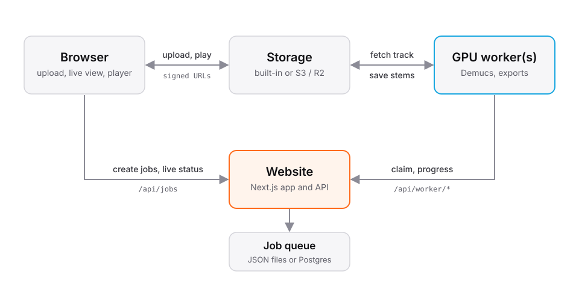

# cloudDSP

[](https://www.clouddsp.ca)
[](https://www.clouddsp.ca)
[](https://github.com/KayTwenty/clouddsp/actions/workflows/ci.yml)
[](LICENSE)
[](https://nextjs.org)
[](worker/pyproject.toml)
[](https://pytorch.org)
[](https://github.com/KayTwenty/clouddsp/commits/main)

Free, open source stem separation for DJs. Upload tracks and get vocals,
drums, bass and melody stems back, ready for your decks:

- **CDJ-3000 with [cdj3k-mods](https://github.com/nsaintot/cdj3k-mods):** stems
  written in the mod's native USB format, so they load on the deck itself.
- **Everything else** (CDJ-3000X, CDJ-2000 series, XDJ-XZ / AZ / RX3, Denon
  Engine DJ players, rekordbox, Serato, Traktor, any DAW): each stem as its own
  WAV, FLAC or MP3, plus an instrumental.

Separation runs on GPUs with [Demucs](https://github.com/facebookresearch/demucs).
The site shows the separation live as it happens, lets you audition every stem
in the browser and download single files or one zip.

Hosted at **[clouddsp.ca](https://www.clouddsp.ca)**, or run your own copy.

## Run it on your own computer

You need an NVIDIA GPU, [Node.js 22+](https://nodejs.org),
[uv](https://docs.astral.sh/uv/) and [ffmpeg](https://ffmpeg.org).

```bash
git clone https://github.com/KayTwenty/clouddsp.git
cd clouddsp
npm install
npm run selfhost
```

Open http://localhost:3000. That's the whole setup: the website and a GPU worker
using your local GPU run together, files and jobs are stored on this machine and
deleted after 48 hours. No cloud accounts, no configuration. The first run
builds the site and downloads the right PyTorch build for your GPU (GTX 10-series
through RTX 50-series are detected automatically).

Prefer containers? `docker compose up -d --build` does the same.
See [docs/self-hosting.md](docs/self-hosting.md) for Docker, running on a home
server for other people, adding more GPUs and every setting.

## Deploy publicly

The hosted version runs the website on Vercel with Prisma Postgres for the job
queue and Cloudflare R2 for files, while GPU workers on home machines pull jobs
over HTTPS. See [docs/deploy-vercel.md](docs/deploy-vercel.md).

## How it works

<p align="center">
  
</p>

Workers only make outgoing requests, so a GPU can sit anywhere: the same
machine, a home server or a rented cloud GPU. Storage and the queue each have a
zero-setup local mode and a scalable mode (any S3-compatible storage, Postgres).
More in [docs/architecture.md](docs/architecture.md).

## Project layout

| Path | What's there |
|---|---|
| `app/` | Next.js pages, API routes and UI components |
| `app/api/` | Job, storage, status and worker endpoints |
| `app/ui/` | Uploader, device picker, live visualizer, stem player, 3D side panels |
| `lib/` | Device list, site settings and server code (job queue, storage) |
| `prisma/` | Database schema and migrations (Postgres mode) |
| `worker/` | Python GPU worker: separation, exports, live telemetry |
| `scripts/selfhost.mjs` | The one-command local launcher |
| `docs/` | Self-hosting, deployment and architecture guides |

## Development

```bash
npm install
npm run dev      # website on http://localhost:3000
npm run worker   # GPU worker, in a second terminal
```

`npm run lint` and `npm run typecheck` check the code. Contributions are welcome,
see [CONTRIBUTING.md](CONTRIBUTING.md).

## License

cloudDSP is free software under the [GNU AGPL v3](LICENSE). You can use, modify
and self-host it. If you run a modified version as a public website, the
license asks you to share your changes with its users; the footer's "Source
code" link (`NEXT_PUBLIC_SOURCE_URL`) is there for that.

cloudDSP is an independent project and is not affiliated with or endorsed by
AlphaTheta, Pioneer DJ, Denon DJ, inMusic or the developers of any firmware mod.
It does not distribute firmware. Product names are used only to describe
compatibility. Only process music you have the rights to use.
