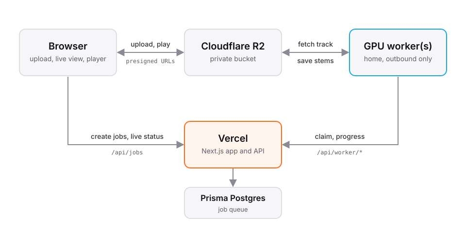

# Deploying cloudDSP on Vercel

This is how the public instance at clouddsp.ca runs. To run cloudDSP on your
own machine or server instead, see [self-hosting.md](self-hosting.md). Any
S3-compatible storage works in place of R2 (see the `S3_*` settings there).

<p align="center">
  
</p>

Audio never passes through Vercel: the browser and the workers move files
straight to and from R2 with short-lived signed URLs. Vercel only hands out
those URLs and keeps the job queue in Postgres. Workers make outbound HTTPS
requests only, so the home cluster needs no open ports.

Locally, anything left unconfigured falls back to `.data/`: jobs as JSON files
and files on disk. `npm run dev` + `npm run worker` work with zero setup.

## 1. Cloudflare R2

1. **Create a bucket**, e.g. `clouddsp`.
2. **API token**: R2 › Manage API tokens › Create. Permission *Object Read &
   Write*, limited to that bucket. Note the Access Key ID, Secret Access Key and
   your Account ID.
3. **CORS policy** (bucket › Settings › CORS), so the browser can upload,
   stream previews and build zips:

   ```json
   [
     {
       "AllowedOrigins": ["https://YOUR-APP.vercel.app", "http://localhost:3000"],
       "AllowedMethods": ["GET", "PUT", "HEAD"],
       "AllowedHeaders": ["Content-Type", "Range"],
       "ExposeHeaders": ["Content-Length", "Content-Range", "ETag"],
       "MaxAgeSeconds": 3600
     }
   ]
   ```

   Add your custom domain too if you use one.
4. **Auto-delete** (bucket › Settings › Object lifecycle rules): delete objects
   after 2 days. Uploaded tracks and results then clean themselves up.

## 2. Vercel

1. Import the repository.
2. **Storage › Prisma Postgres** from the Marketplace, connected to the project.
   It injects the connection settings. The app reads `DATABASE_URL`, which must
   be the direct `postgres://` connection string (not `prisma+postgres://`).
   If the integration names it differently, add `DATABASE_URL` with that value.
3. **Environment variables** (see `.env.example`):

   | Variable | Value |
   |---|---|
   | `R2_ACCOUNT_ID` | Cloudflare account ID |
   | `R2_ACCESS_KEY_ID` | from the R2 token |
   | `R2_SECRET_ACCESS_KEY` | from the R2 token |
   | `R2_BUCKET` | bucket name |
   | `WORKER_TOKEN` | long random secret, see below |

   Generate a worker token with:

   ```bash
   node -e "console.log(require('crypto').randomBytes(32).toString('hex'))"
   ```

   Without `WORKER_TOKEN`, production refuses every worker.
4. Deploy. Vercel runs `npm run vercel-build`, which generates the Prisma
   client, applies migrations (`prisma migrate deploy`) and builds Next.js.

## 3. GPU workers

On each GPU machine (needs `uv`, `ffmpeg` and an NVIDIA driver), from the
repository root:

```powershell
$env:CLOUDDSP_URL = "https://YOUR-APP.vercel.app"
$env:WORKER_TOKEN = "<the token>"
uv run --no-project worker/start.py
```

`worker/start.py` (also `npm run worker`) asks `nvidia-smi` which GPU and
driver are installed, installs the matching PyTorch build on first run and
starts the worker:

| GPU | Build | Driver |
|---|---|---|
| GTX 10-series (Pascal) | `cu126` | 560+ |
| RTX 20 / 30 / 40-series | `cu128` on driver 570+, otherwise `cu126` | 560+ |
| RTX 50-series (Blackwell) | `cu128` | 570+ |
| No NVIDIA GPU | default PyTorch (CPU) | |

Add `--dry-run` to only print the choice, or set `CLOUDDSP_TORCH=cu126` /
`cu128` to override it. A machine mixing a GTX 10-series and an RTX 50-series
card needs one worker per GPU (`CUDA_VISIBLE_DEVICES=0`, `=1`), since no single
build supports both.

Optional: `$env:WORKER_NAME = "Rack 1 GPU 2"` sets how the worker appears on the
public `/status` page (default: the GPU model). The machine's hostname is never
sent. When the worker runs inside the site checkout, it also reads
`CLOUDDSP_URL` and `WORKER_TOKEN` from the repo's `.env` / `.env.local` if they
aren't set in the shell.

Run one worker per GPU. Any number can poll at once: jobs are claimed with
`FOR UPDATE SKIP LOCKED`, and a job whose worker goes silent for two minutes is
handed to another worker automatically. Workers ride out site restarts and
redeploys by retrying.

## Notes

- **SEO**: canonical URLs, the sitemap and social cards use the production
  domain Vercel provides automatically. With a custom domain, set
  `NEXT_PUBLIC_SITE_URL=https://your-domain` so they point at it.
- **Privacy claims**: the About page promises files are deleted within 48
  hours. That's true once the R2 lifecycle rule from step 1 is in place.
- **Vercel plan**: Hobby is for non-commercial use. A free community tool is
  likely fine; check Vercel's terms, and use Pro if it's ever monetized.
- **Schema changes**: edit `prisma/schema.prisma`, run
  `npx prisma migrate dev --name <change>` against a dev database, commit the
  new folder in `prisma/migrations`. The next deploy applies it.
- **Windows builds**: build from the folder's real casing
  (`Downloads\clouddsp`). Opening it as `cloudDSP` makes the bundler load
  React twice and prerendering fails.
